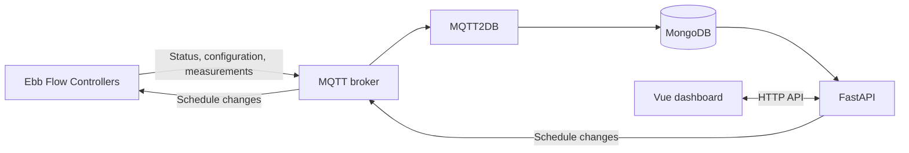

[](https://github.com/phofmeier/EbbFlowManager/actions/workflows/release.yml)
[](https://github.com/phofmeier/EbbFlowManager/actions/workflows/pre-commit.yml)
[](https://github.com/phofmeier/EbbFlowManager/actions/workflows/unit-tests.yml)

# EbbFlowManager

EbbFlowManager monitors ebb-and-flow hydroponic racks and lets you edit their
nutrition pump and grow-light schedules. The Vue dashboard shows controller
status, reservoir readings, device diagnostics, and crop-phase targets.

Each rack runs independently on an [Ebb Flow Controller](https://github.com/phofmeier/EbbFlowControl).
Controllers report status, configuration, and measurements over MQTT.
[MQTT2DB](https://github.com/phofmeier/mqtt2db) records those messages in MongoDB.
FastAPI reads the stored data and publishes schedule changes over MQTT.



## Run the dashboard

### Docker Compose

For a complete local stack, follow the [Docker Compose example](example/README.md).
It serves the dashboard and API together on port `5006` and is for trusted
development networks only. Production requires a separate, authenticated
configuration.

Stable releases publish FastAPI as `ghcr.io/phofmeier/ebbflowmanager:latest`
and the Vue dashboard as `ghcr.io/phofmeier/ebbflowmanager:latest-frontend`.
Use both images together following the [published image instructions](example/README.md#use-published-images).

### Run FastAPI and Vite directly

Use Python 3.13 or later, `uv`, and Node.js 24 with npm. FastAPI requires
`EBBFLOW_CONFIG` at startup. Copy the [example manager YAML](example/manager/config/config.yml)
to `config.yml` at the repository root. Set `database.connection_string` and
`mqtt.broker` to addresses reachable from FastAPI. The example's `db` and
`mosquitto` service names resolve inside Compose and the dev container. For
FastAPI running on the host against the example stack, use `localhost:27017`
and `localhost`, respectively. Run the [catalog imports](#manage-the-catalogs)
before starting the API.

```sh
EBBFLOW_CONFIG=config.yml \
  uv run --locked uvicorn ebb_flow_manager_api.app:app --reload --host 0.0.0.0 --port 8001
```

In a second terminal, run these commands from the repository root and open
[http://localhost:5173/](http://localhost:5173/). Vite forwards API requests to
port `8001`.

```sh
npm --prefix frontend ci
npm --prefix frontend run dev
```

For a demo with sample controllers, use the [dev container](#dev-container).
The controller list comes from `status_static`.
FastAPI reads reported schedules from `config_static`, reservoir history from
`level_timed`, and heap and storage diagnostics from `heap_timed`. Override the
collection names in the manager YAML when using a different MongoDB layout.

Schedule edits require a connected controller. Pump runs require a positive
duration when starts are set. Clear the start times to disable scheduled pumping.
A pump run or light transition may end at the next scheduled start, and light
transitions in a schedule with multiple changes must finish before midnight.

Each dashboard includes `schedule_revisions` for `pump` and `light`. The editor
sends the revision from when it opened. API clients can send the same value in
the `X-Schedule-Revision` header when saving a schedule. If the reported schedule
has changed and differs from the requested schedule, the API returns HTTP 409.

FastAPI publishes changed schedules over MQTT and returns `applied` after a
matching MongoDB report whose `ts_received` is at or after the save began and
newer than the previous report. If the schedule already matches the last report,
the API returns `unchanged`. If it returns `unconfirmed`, refresh the controller
and check the reported schedule.

## Use the dashboard

### Crop and grow-phase targets

Select a crop and then a grow phase in the dashboard header. The dashboard
shows pH, EC, and water temperature targets in **Reservoir**, air temperature
and humidity targets in **Climate**, and PPFD and DLI targets in **Grow light**.
Unspecified targets appear as **Not set**. In live mode, MongoDB stores the
per-controller selection in `grow_selections` and the catalog in `crop_profiles`.

### Grow-light estimates and scheduling

Open **Grow light settings**, select a fixture, and choose **Save fixture**.
Enter the canopy distance in the **Grow light** panel and choose **Save
distance**. These settings are stored per controller in
`grow_light_installations` in live mode. The chart shows fixture output on
the left axis and estimated PPFD on the right. Scheduled DLI is the estimated
light integral over the 24-hour schedule.

To draft a schedule, open **Calculate from targets** in **Grow light settings**.
Enter canopy distance, maximum PPFD, DLI, and rise time, then choose
**Calculate schedule**. The draft uses one on entry and one off entry with the
same transition time. The full light window, including both ramps, is centered
on controller noon. A 12-hour window runs from 06:00 to 18:00. Use **Save
distance** if the draft uses a different canopy distance that should also
appear in the dashboard. Review the estimated peak and DLI, then choose
**Save schedule**.

## Manage the catalogs

See the bundled [crop profiles](src/ebb_flow_manager_api/data/crops/README.md) and
[grow-light fixtures](src/ebb_flow_manager_api/data/grow_lights/README.md)
for data notes and sources.

FastAPI reads the catalogs from MongoDB. To initialize them for a direct
FastAPI launch, run these commands from the repository root with your manager
YAML. The Docker API image runs both imports before starting FastAPI.

```sh
uv run --locked python -m ebb_flow_manager_api.import_crop_profiles --config config.yml
uv run --locked python -m ebb_flow_manager_api.import_grow_lights --config config.yml
```

Both commands validate all source files before writing. Use `EBBFLOW_CONFIG`
in place of `--config`, or pass `--source` to read another directory. The
default import inserts missing records. The bundled crop import also adds the
production reservoir temperature to legacy lettuce targets that still match
the previous defaults. With `--update`, the crop importer
updates crop names and replaces the phases supplied in the source. The
fixture importer updates fixture names and PPFD tables. Controller selections
and fixture assignments are stored separately and survive a re-import.

When running FastAPI directly, its interactive API reference is at
[http://localhost:8001/docs](http://localhost:8001/docs). Use the routes below
to manage catalogs, selections, and installations.

| Method and path                                                  | Purpose                                                                   |
| ---------------------------------------------------------------- | ------------------------------------------------------------------------- |
| `GET /api/crops`                                                 | List crops and their phases.                                              |
| `PUT /api/crops/{crop_id}/phases/{phase_id}`                     | Create or replace a phase using `crop_name`, `phase_name`, and `targets`. |
| `PUT /api/controllers/{controller_id}/grow-selection`            | Save the controller's `crop_id` and `phase_id`.                           |
| `GET /api/grow-lights`                                           | List fixtures and their PPFD tables.                                      |
| `GET /api/grow-lights/{light_id}/ppfd`                           | Estimate PPFD from `output_percent` and `canopy_distance_cm`.             |
| `PATCH /api/controllers/{controller_id}/grow-light-installation` | Update `grow_light_id` or `canopy_distance_cm`. Use `PUT` to send both.   |
| `POST /api/controllers/{controller_id}/light/suggestion`         | Calculate a draft schedule for the saved fixture.                         |

Each target is optional and takes `min` and `max`. Use equal bounds for a
single value. Crop and phase IDs use lowercase letters, digits, and hyphens.

The controller dashboard response includes `grow_light_installation`. When a
fixture and distance are saved, it includes `ppfd` on light schedule changes
and curve points, plus `light.dli_mol_m2_day` and `light.dli_status`.

## Development

### Dev container

In VS Code, select **Dev Containers: Reopen in Container**. If you already have
a container, use **Rebuild Container** to rerun setup. The container starts
MongoDB, Mosquitto, and MQTT2DB. The [setup script](.devcontainer/setup.sh)
installs the FastAPI and Vue dependencies, builds Vue, loads the catalogs and
seeds two sample controllers in `efc`, and installs pre-commit hooks.

Start FastAPI from the workspace root with the example YAML to see the seeded
controller records. Start Vite in a second container terminal with
`npm --prefix frontend run dev`.

```sh
EBBFLOW_CONFIG=example/manager/config/config.yml \
  uv run --locked uvicorn ebb_flow_manager_api.app:app --reload --host 0.0.0.0 --port 8001
```

To re-import the bundled data in the dev container, run from the workspace root.

```sh
export EBBFLOW_CONFIG="$PWD/example/manager/config/config.yml"
uv run --no-sync python -m ebb_flow_manager_api.import_crop_profiles
uv run --no-sync python -m ebb_flow_manager_api.import_grow_lights
uv run --no-sync tools/seed_demo_controllers.py
```

### Legacy Panel

Panel is archived for manual use. See the [legacy Panel guide](legacy/panel/README.md)
for setup, launch, and test instructions.

### Checks

Run the FastAPI tests and build the frontend from the repository root after
installing the frontend dependencies.

```sh
uv run --locked --extra dev pytest
npm --prefix frontend run build
```

See [AGENTS.md](AGENTS.md) for development conventions.

## Releases

See the [release guide](RELEASING.md) for publishing a version and the
[changelog](CHANGELOG.md) for release notes.
